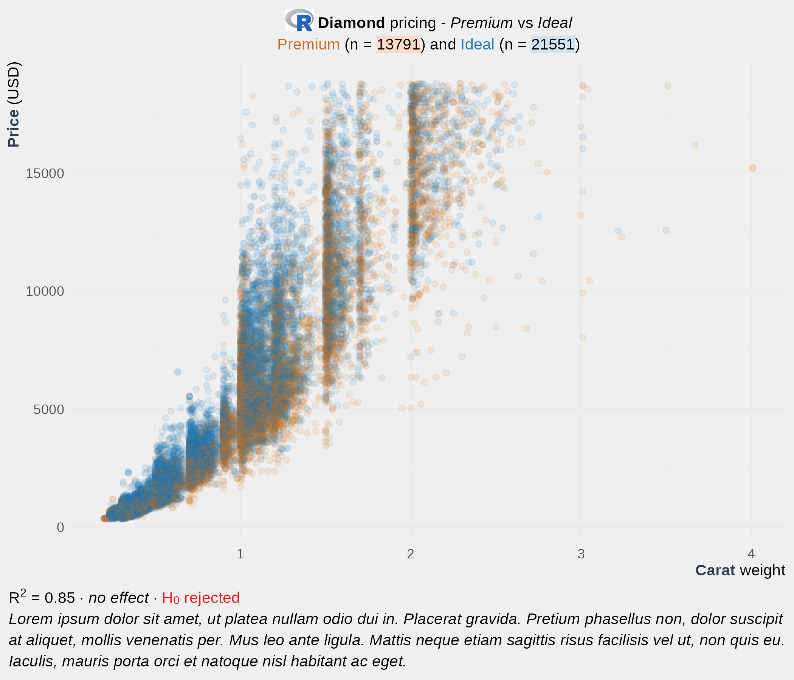
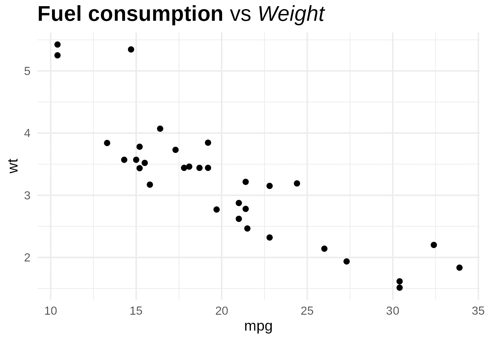
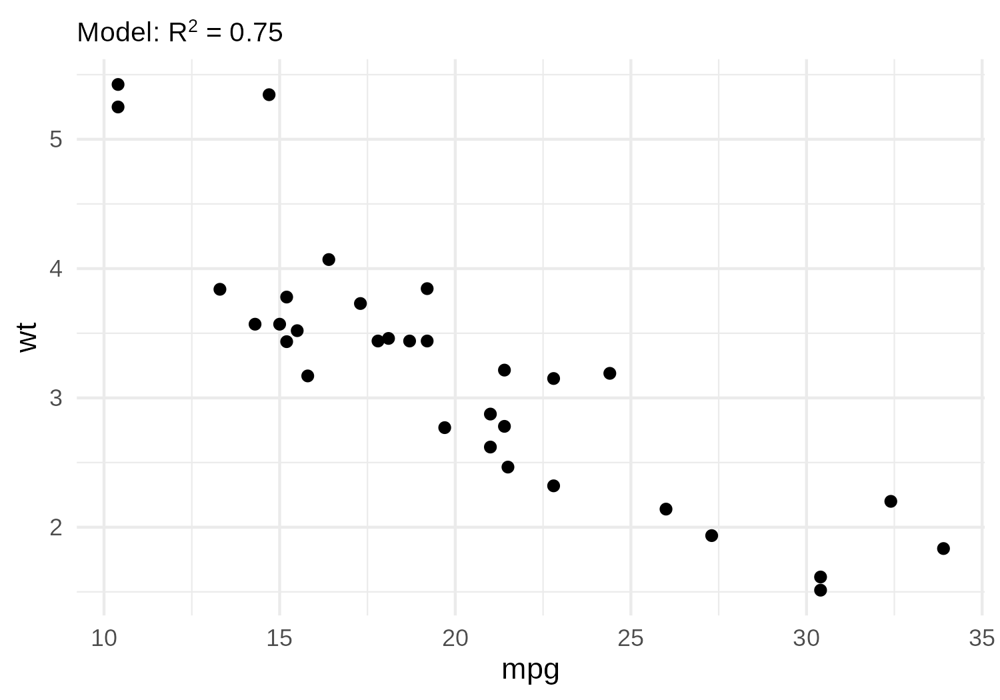
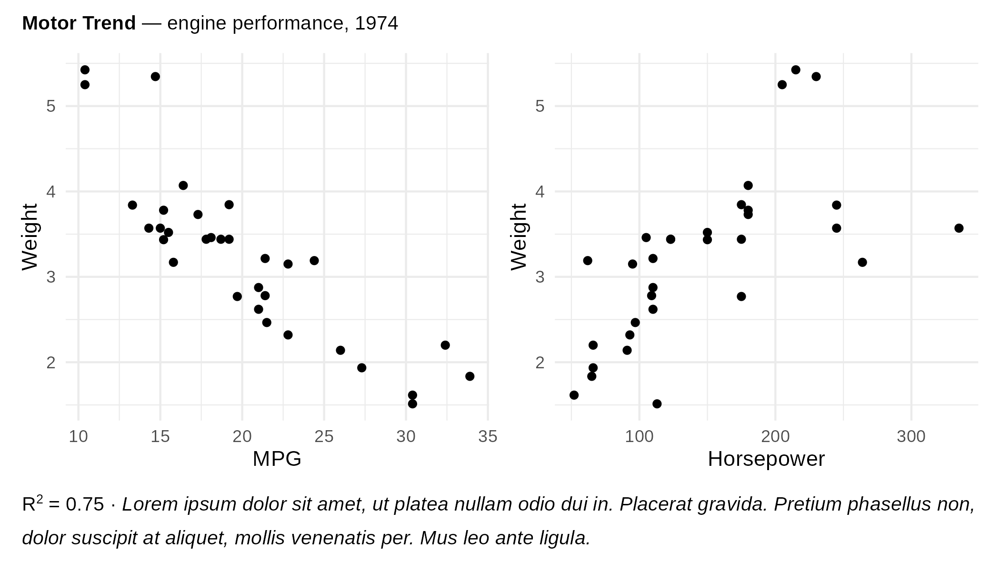
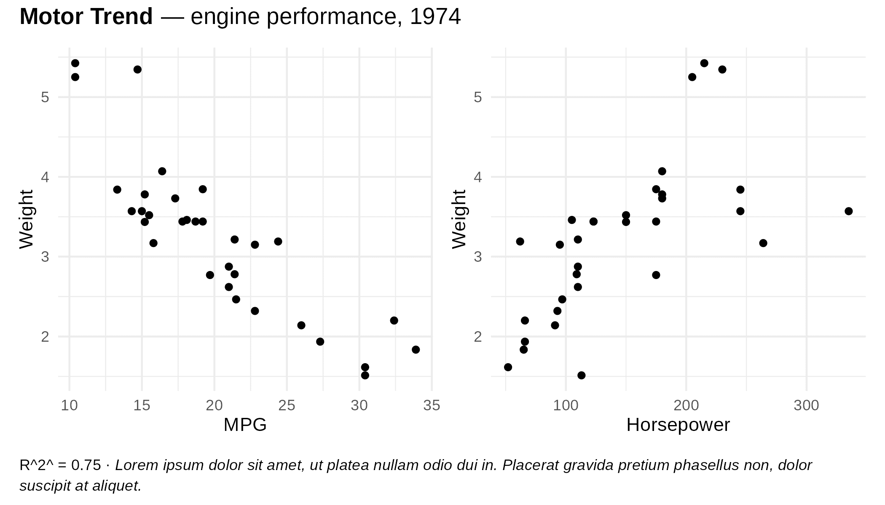
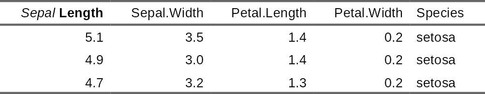
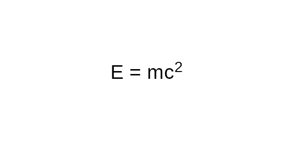

munch
================

<!-- README.md is generated from README.Rmd. Please edit that file -->

[](https://github.com/ardata-fr/munch/actions/workflows/R-CMD-check.yaml)

> ‘munch’ crunches markdown text and ‘flextable’ paragraphs into grid
> graphics.

‘munch’ started as internal code in ‘flextable’ for rendering rich text
with ‘grid’. It was extracted into its own package to also serve
‘ggiraph’ and to provide unified formatting between ‘ggplot2’ graphics
and ‘flextable’ tables.

‘munch’ lets you produce this annotated graphic:



The title, subtitle, caption and axis labels above are all built with
`element_chunks()` and ‘flextable’ paragraph objects, bold, italic,
colors, highlights, superscripts, subscripts, strikethrough and an
embedded image.

| Function | Purpose | Input |
|----|----|----|
| `element_md()` | Markdown in theme elements | Character string |
| `element_chunks()` | Advanced formatting in theme elements | `as_paragraph()` object |
| `geom_text_md()` | Markdown text annotations | `label` aesthetic |
| `geom_label_md()` | Markdown labels with background | `label` aesthetic |

## Installation

Install the released version from CRAN:

``` r
install.packages("munch")
```

Or the development version from GitHub:

``` r
# install.packages("pak")
pak::pak("ardata-fr/munch")
```

## Supported graphics devices

‘munch’ requires graphics devices that support ‘systemfonts’:
[‘ragg’](https://ragg.r-lib.org/),
[‘svglite’](https://svglite.r-lib.org/), or
[‘ggiraph’](https://davidgohel.github.io/ggiraph/). ‘cairo’ devices are
also supported when fonts are installed at the system level. See
`vignette("font-recipes")` for font configuration, alternative devices,
and troubleshooting.

## Quick start

### ggplot2

Use `element_md()` for markdown in theme elements, and `geom_text_md()`
or `geom_label_md()` for annotations:

``` r
library(ggplot2)

ggplot(mtcars, aes(mpg, wt)) +
 geom_point() +
 labs(title = "**Fuel consumption** vs *Weight*") +
 theme(plot.title = element_md(size = 16))
```



For advanced formatting (superscripts, subscripts, colors), use
`element_chunks()` with ‘flextable’ paragraph objects:

``` r
title_chunks <- as_paragraph(
 as_chunk("Model: R"), as_sup("2"), as_chunk(" = 0.75")
)

ggplot(mtcars, aes(mpg, wt)) +
 geom_point() +
 theme(plot.title = element_chunks(title_chunks))
```



#### Syntax comparison

| Syntax        | `element_md()`        | `element_chunks()`  |
|---------------|-----------------------|---------------------|
| Bold / Italic | `**text**` / `*text*` | `as_b()` / `as_i()` |
| Inline code   | `` `code` ``          | x                   |
| Strikethrough | `~~text~~`            | `as_strike()`       |
| Superscript   | x                     | `as_sup()`          |
| Subscript     | x                     | `as_sub()`          |
| Custom colors | x                     | `colorize()`        |
| Highlighting  | x                     | `as_highlight()`    |

### Patchwork integration

Use `munch_annotation()` as a drop-in replacement for
`patchwork::plot_annotation()` that accepts `element_chunks()` and
`element_md()`. It adds rich-text titles, subtitles and captions to
combined plots, with automatic wrapping:

``` r
library(ggplot2)
library(patchwork)

p1 <- ggplot(mtcars, aes(mpg, wt)) +
  geom_point() +
  labs(x = "MPG", y = "Weight")

p2 <- ggplot(mtcars, aes(hp, wt)) +
  geom_point() +
  labs(x = "Horsepower", y = "Weight")

title_chunks <- as_paragraph(
  as_b("Motor Trend"), as_chunk(" — engine performance, 1974")
)

caption_chunks <- as_paragraph(
  as_chunk("R"), as_sup("2"), as_chunk(" = 0.75 · "),
  as_i("Lorem ipsum dolor sit amet, ut platea nullam odio dui in. "),
  as_i("Placerat gravida. Pretium phasellus non, dolor suscipit at aliquet, "),
  as_i("mollis venenatis per. Mus leo ante ligula.")
)

wrap_plots(p1, p2) +
  munch_annotation(
    title   = element_chunks(title_chunks),
    caption = element_chunks(caption_chunks, lineheight = 1.5, hjust = 0)
  )
```



For plain markdown text, pass the content as a string and use
`element_md()` in the `theme` argument, as in regular ggplot2 theming:

``` r
wrap_plots(p1, p2) +
  munch_annotation(
    title   = "**Motor Trend** — engine performance, 1974",
    caption = "R² = 0.75 · *Lorem ipsum dolor sit amet, ut platea nullam odio dui in. Placerat gravida pretium phasellus non, dolor suscipit at aliquet.*",
    theme   = theme(
      plot.title   = element_md(),
      plot.caption = element_md(lineheight = 1.5, hjust = 0)
    )
  )
```



The caption auto-wraps to the full figure width at render time, so it
works correctly regardless of output size. `title`, `subtitle`, and
`caption` each accept an `element_chunks()` or `element_md()` object, a
bare `as_paragraph()` object, or a plain character string.

### flextable

Use `as_paragraph_md()` for markdown in table cells:

``` r
ft <- flextable(head(iris, 3))
ft <- mk_par(ft, j = 1, part = "header",
 value = as_paragraph_md("*Sepal* **Length**"))
autofit(ft)
```



### Markdown to grob

``` r
library(munch)
library(grid)

gr <- md_grob("This is **bold** and *italic* text.")
grid.newpage()
grid.draw(gr)
```


For superscripts, subscripts, or colors not available in markdown, use
‘flextable’ chunks with `chunks_grob()`:

``` r
library(flextable)

chunks <- as_paragraph(as_chunk("E = mc"), as_sup("2"))
gr <- chunks_grob(chunks)
grid.newpage()
grid.draw(gr)
```



## Learn more

- [Using munch with
  ggplot2](https://ardata-fr.github.io/munch/articles/using-ggplot2.html) -
  `element_md()`, `element_chunks()`, `geom_text_md()`,
  `geom_label_md()`
- [Advanced
  usage](https://ardata-fr.github.io/munch/articles/advanced-usage.html) -
  `md_grob()`, `chunks_grob()`, text properties, images
- [Font
  recipes](https://ardata-fr.github.io/munch/articles/font-recipes.html) -
  font configuration, device compatibility, troubleshooting

## Comparisons

### ‘gridtext’

[‘gridtext’](https://wilkelab.org/gridtext/) by Claus O. Wilke (used by
[‘ggtext’](https://wilkelab.org/ggtext/)) renders formatted text via a
subset of HTML/CSS. ‘munch’ takes a different approach: it uses markdown
or ‘flextable’ chunks as input and relies on ‘systemfonts’ for text
measurement.

|  | munch | gridtext |
|----|----|----|
| Input format | Markdown, flextable chunks | HTML / CSS subset |
| Superscript / subscript | Yes (`as_sup()`, `as_sub()`) | Yes (`<sup>`, `<sub>`) |
| Custom colors / highlight | Yes (via `colorize()`, `as_highlight()`) | Yes (via inline CSS) |
| Inline images | Yes | Yes |
| Text wrapping | Yes | Yes (`textbox_grob()`) |
| Integration with ‘flextable’ | Yes (shared chunk model) | No |
| Supported devices | ‘ragg’, ‘svglite’, ‘ggiraph’, cairo | Most R graphic devices |
| Compiled code | No (pure R) | Yes (C++ via ‘Rcpp’) |

### with ‘marquee’

[‘marquee’](https://marquee.r-lib.org/) by Thomas Lin Pedersen offers
more markdown features (headings, lists, code blocks, custom spans).
‘munch’ focuses first on integration with ‘flextable’ chunks and
advanced formatting not available in markdown.

- ‘munch’ works with ‘ragg’, ‘svglite’, ‘ggiraph’, `cairo_pdf()`,
  `png(type = "cairo")`, and possibly `pdf()` with some care (see
  `vignette("font-recipes")`).
- ‘marquee’ works on a wide range of R devices but not yet with
  ‘svglite’ or ‘ggiraph’.
- With markdown, ‘munch’ only handles inline formatting (paragraphs are
  separated by an empty line), while ‘marquee’ also handles blocks such
  as headings, lists and code blocks.
