# Using munch with ggplot2

``` r

library(munch)
library(ggplot2)
library(flextable)
library(gdtools)
fset <- font_set_liberation()
set_theme(theme_minimal(base_family = "Liberation Sans", base_size = 11))
```

This vignette covers formatting in ‘ggplot2’ theme elements and text
annotations using ‘munch’.

## Simple markdown with element_md()

[`element_md()`](https://ardata-fr.github.io/munch/reference/element_md.md)
replaces
[`element_text()`](https://ggplot2.tidyverse.org/reference/element.html)
to render markdown in titles, subtitles, captions, and axis labels.

``` r

ggplot(mtcars, aes(mpg, wt)) +
  geom_point() +
  labs(
    title = "**Fuel Consumption** vs *Weight*",
    subtitle = "Data from the `mtcars` dataset",
    caption = "Source: *Motor Trend* (1974)"
  ) +
  theme(
    plot.title = element_md(size = 16),
    plot.subtitle = element_md(size = 12, code_font_family = "Liberation Mono"),
    plot.caption = element_md(size = 9)
  )
```

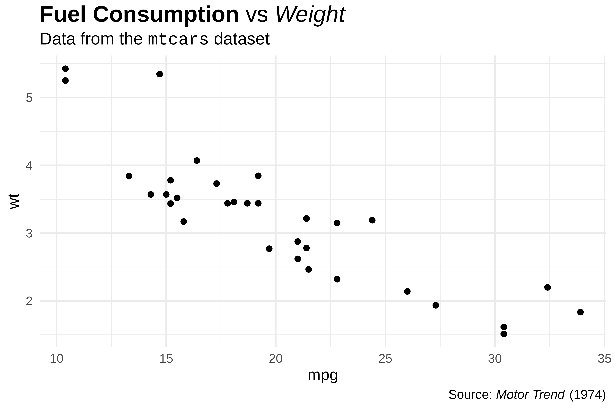

``` r

ggplot(mtcars, aes(hp, mpg)) +
  geom_point() +
  labs(
    x = "Horsepower (*hp*)",
    y = "Miles per gallon (**mpg**)"
  ) +
  theme(
    axis.title.x = element_md(),
    axis.title.y = element_md()
  )
```

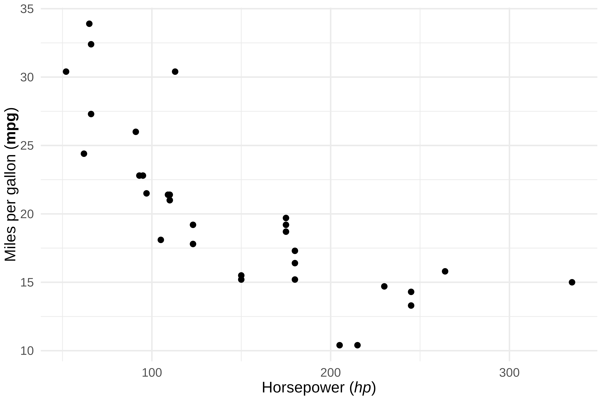

> For advanced markdown rendering (images, spans, custom CSS), see also
> `marquee::element_marquee()`.

### Long titles

Titles, subtitles and captions wrap to the width of their column, and
the plot keeps the space they need:

``` r

long_title <- paste(
  "A **long title** that needs several lines, because it is wider",
  "than the *panel* of the plot"
)

p <- ggplot(mtcars, aes(mpg, wt)) +
  geom_point() +
  labs(title = long_title) +
  theme(plot.title = element_md())
p
```

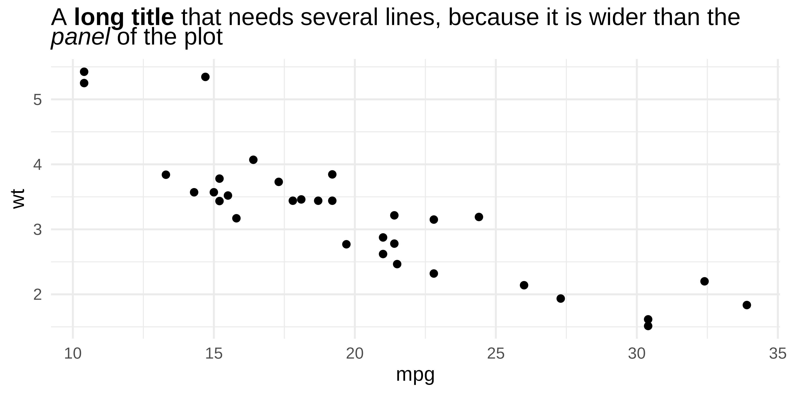

With ‘patchwork’, or with a fixed aspect ratio such as
[`coord_fixed()`](https://ggplot2.tidyverse.org/reference/coord_fixed.html),
this width is not known when the height of the title is computed. The
text may need more lines than the space kept for it, and its first lines
are cut. Set the maximum width of the text with `width`, in inches:

``` r

library(patchwork)

p <- p + theme(plot.title = element_md(width = 2.5))
p | p
```

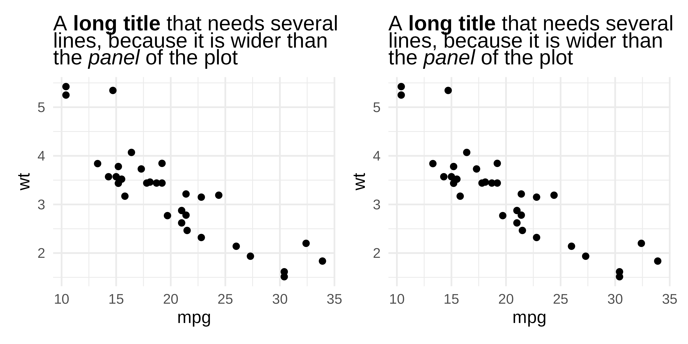

## Advanced formatting with element_chunks()

[`element_chunks()`](https://ardata-fr.github.io/munch/reference/element_chunks.md)
uses ‘flextable’ formatting functions
([`as_paragraph()`](https://davidgohel.github.io/flextable/reference/as_paragraph.html),
[`as_chunk()`](https://davidgohel.github.io/flextable/reference/as_chunk.html),
etc.) to build rich text with superscripts, subscripts, colors, and
highlighting, features that markdown does not support.

### The as_paragraph() vocabulary

Build text by combining chunks inside
[`as_paragraph()`](https://davidgohel.github.io/flextable/reference/as_paragraph.html):

| Function | Description | Example |
|----|----|----|
| [`as_chunk()`](https://davidgohel.github.io/flextable/reference/as_chunk.html) | Plain text | `as_chunk("text")` |
| [`as_b()`](https://davidgohel.github.io/flextable/reference/as_b.html) | Bold | `as_b("bold")` |
| [`as_i()`](https://davidgohel.github.io/flextable/reference/as_i.html) | Italic | `as_i("italic")` |
| [`as_sup()`](https://davidgohel.github.io/flextable/reference/as_sup.html) | Superscript | `as_sup("2")` |
| [`as_sub()`](https://davidgohel.github.io/flextable/reference/as_sub.html) | Subscript | `as_sub("2")` |
| [`colorize()`](https://davidgohel.github.io/flextable/reference/colorize.html) | Colored text | `colorize(as_chunk("red"), color = "red")` |
| [`as_highlight()`](https://davidgohel.github.io/flextable/reference/as_highlight.html) | Highlighted | `as_highlight(as_chunk("text"), color = "yellow")` |

``` r

chunks <- as_paragraph(
  as_b("Bold"), as_chunk(", "),
  as_i("italic"), as_chunk(", "),
  as_chunk("x"), as_sup("2"), as_chunk(", "),
  as_chunk("H"), as_sub("2"), as_chunk("O")
)

ggplot(mtcars, aes(mpg, wt)) +
  geom_point() +
  theme(plot.title = element_chunks(chunks))
```

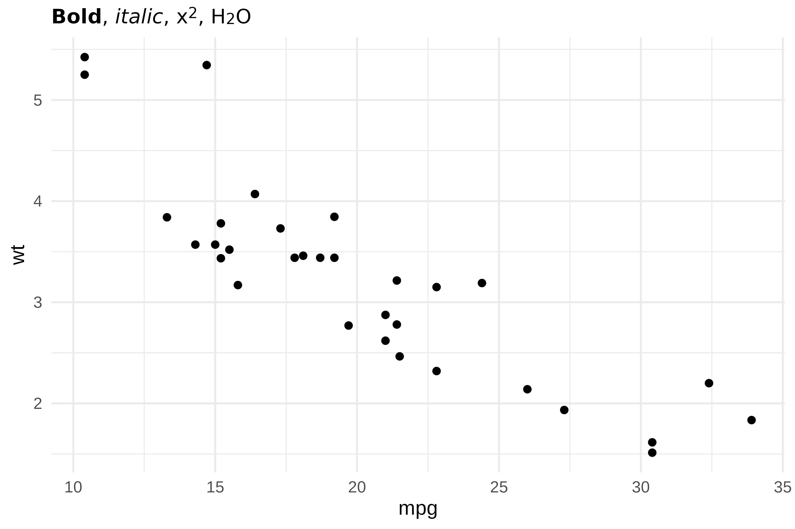

### Scientific notation

Superscripts and subscripts are essential for scientific text.
[`element_chunks()`](https://ardata-fr.github.io/munch/reference/element_chunks.md)
makes them straightforward:

``` r

title_chunks <- as_paragraph(
  as_chunk("Analysis: "),
  as_b("R"), as_sup("2"),
  as_chunk(" = 0.87, "),
  as_i("p"), as_chunk(" < 0.001")
)

ggplot(mtcars, aes(mpg, wt)) +
  geom_point() +
  geom_smooth(method = "lm", se = FALSE) +
  theme(plot.title = element_chunks(title_chunks))
```

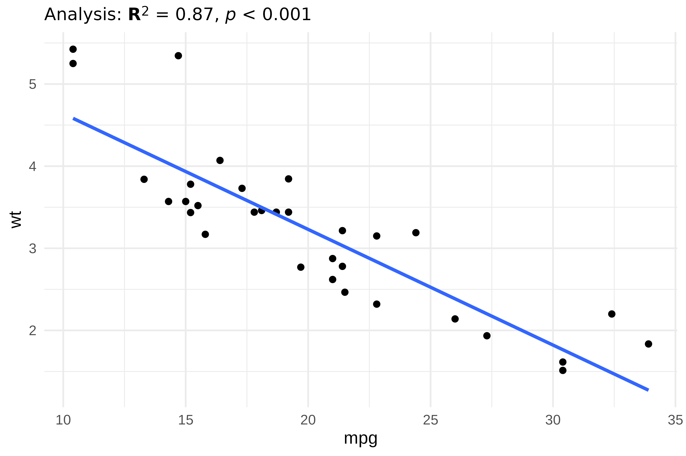

Chemical formulas:

``` r

subtitle_chunks <- as_paragraph(
  as_chunk("Concentration of "),
  as_b("H"), as_sub("2"),
  as_b("SO"), as_sub("4"),
  as_chunk(" in solution")
)

ggplot(mtcars, aes(mpg, wt)) +
  geom_point() +
  theme(plot.subtitle = element_chunks(subtitle_chunks))
```

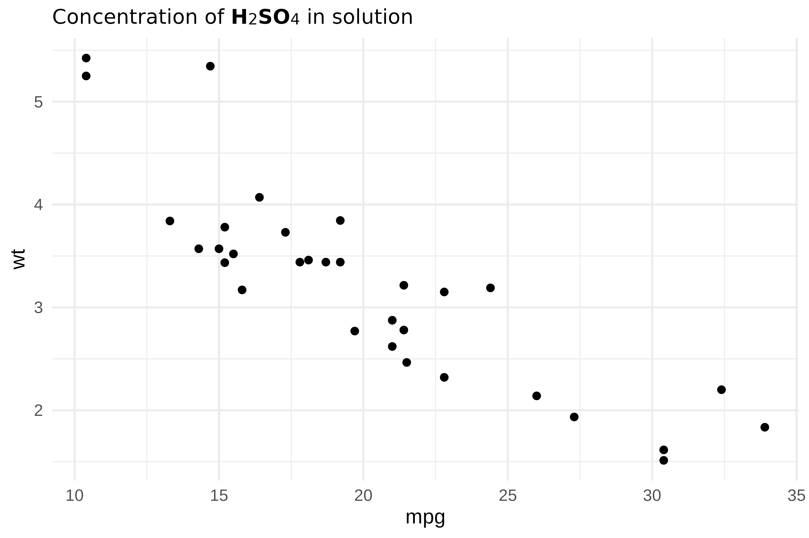

Units with exponents:

``` r

caption_chunks <- as_paragraph(
  as_chunk("Units: mol\u00B7L"), as_sup("-1"),
  as_chunk(" | Speed: m\u00B7s"), as_sup("-2")
)

ggplot(mtcars, aes(mpg, wt)) +
  geom_point() +
  theme(plot.caption = element_chunks(caption_chunks))
```

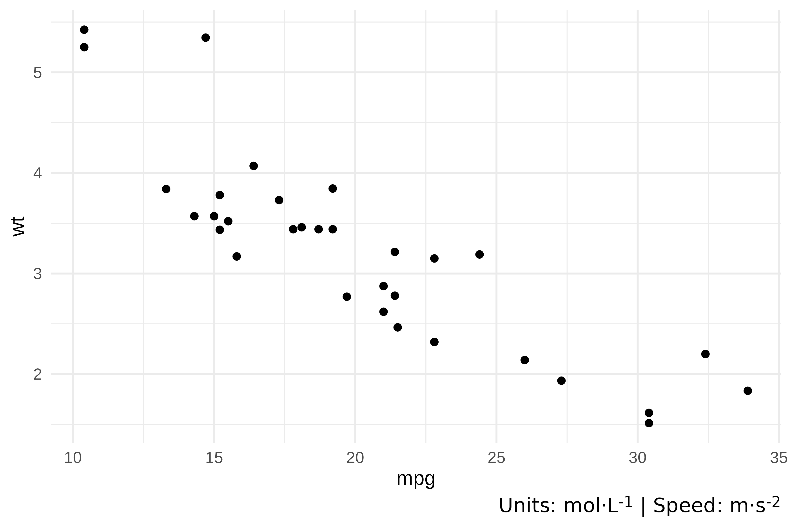

### Colors and highlighting

[`colorize()`](https://davidgohel.github.io/flextable/reference/colorize.html)
and
[`as_highlight()`](https://davidgohel.github.io/flextable/reference/as_highlight.html)
add color and background highlighting:

``` r

title_chunks <- as_paragraph(
  as_chunk("Results: "),
  colorize(as_chunk("significant"), color = "#E63946"),
  as_chunk(" difference")
)

subtitle_chunks <- as_paragraph(
  as_chunk("Compare "),
  as_highlight(as_chunk(" Group A "), color = "yellow"),
  as_chunk(" vs "),
  as_highlight(as_chunk(" Group B "), color = "cyan")
)

ggplot(mtcars, aes(mpg, wt)) +
  geom_point() +
  theme(
    plot.title = element_chunks(title_chunks),
    plot.subtitle = element_chunks(subtitle_chunks)
  )
```

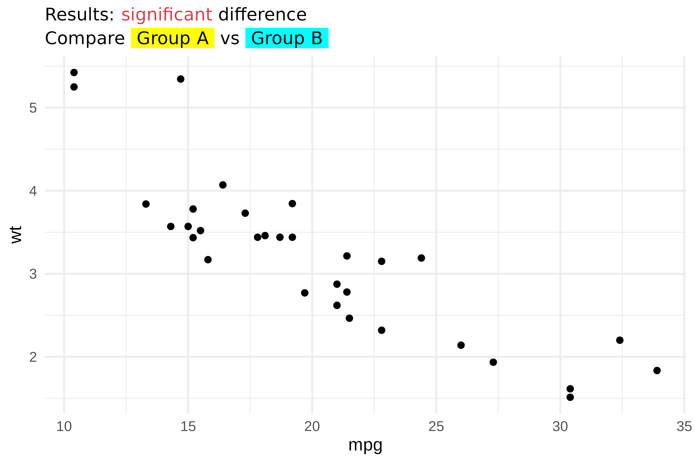

### Images in theme elements

[`as_image()`](https://davidgohel.github.io/flextable/reference/as_image.html)
embeds images inside
[`element_chunks()`](https://ardata-fr.github.io/munch/reference/element_chunks.md).
This is useful for logos or icons in titles:

``` r

r_logo <- file.path(R.home("doc"), "html", "logo.jpg")

title_chunks <- as_paragraph(
  as_image(src = r_logo, width = 0.25, height = 0.2),
  as_chunk(" "),
  as_b("R Project"),
  as_chunk(" - fuel consumption data")
)

ggplot(mtcars, aes(mpg, wt)) +
  geom_point() +
  theme(plot.title = element_chunks(title_chunks))
```

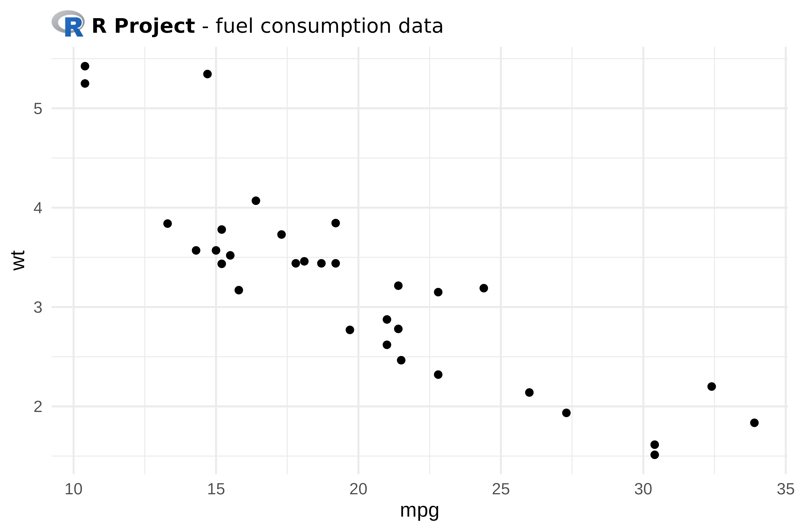

### Layout parameters

[`element_chunks()`](https://ardata-fr.github.io/munch/reference/element_chunks.md)
accepts the same layout parameters as
[`element_md()`](https://ardata-fr.github.io/munch/reference/element_md.md):

| Parameter    | Description                          |
|--------------|--------------------------------------|
| `hjust`      | Horizontal justification (0-1)       |
| `vjust`      | Vertical justification (0-1)         |
| `angle`      | Text rotation angle                  |
| `lineheight` | Line height multiplier               |
| `margin`     | Margins around text                  |
| `width`      | Maximum width of the text, in inches |

``` r

chunks <- as_paragraph(
  as_chunk("Centered: R"), as_sup("2"),
  as_chunk(" = 0.75")
)

ggplot(mtcars, aes(mpg, wt)) +
  geom_point() +
  theme(plot.title = element_chunks(chunks, hjust = 0.5))
```

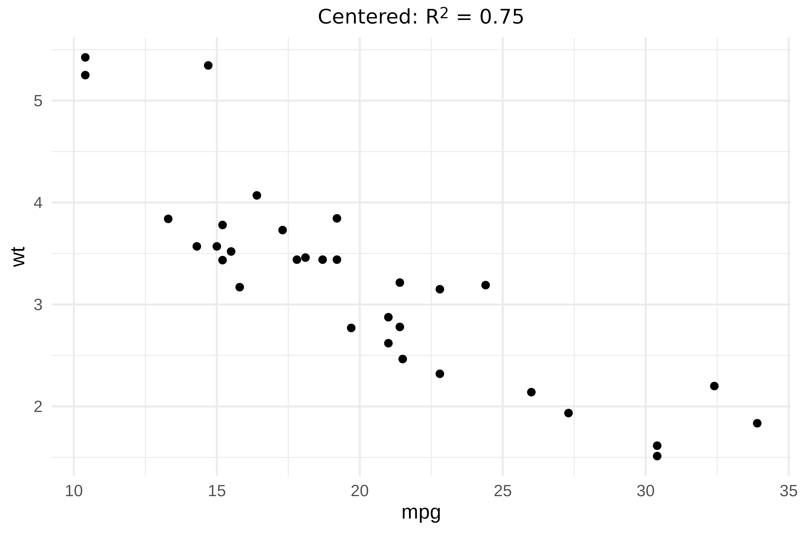

## Text annotations with geom_text_md() and geom_label_md()

[`geom_text_md()`](https://ardata-fr.github.io/munch/reference/geom_text_md.md)
and
[`geom_label_md()`](https://ardata-fr.github.io/munch/reference/geom_label_md.md)
render markdown-formatted labels directly on the plot, similar to
[`geom_text()`](https://ggplot2.tidyverse.org/reference/geom_text.html)
and
[`geom_label()`](https://ggplot2.tidyverse.org/reference/geom_text.html).

``` r

annotations <- data.frame(
  x = c(15, 25, 30),
  y = c(4, 3, 2),
  label = c("**Group A**", "*Group B*", "`Group C`")
)

ggplot(mtcars, aes(mpg, wt)) +
  geom_point(alpha = 0.5) +
  geom_text_md(
    data = annotations,
    aes(x = x, y = y, label = label),
    size = 4,
    code_font_family = "Liberation Mono"
  )
```

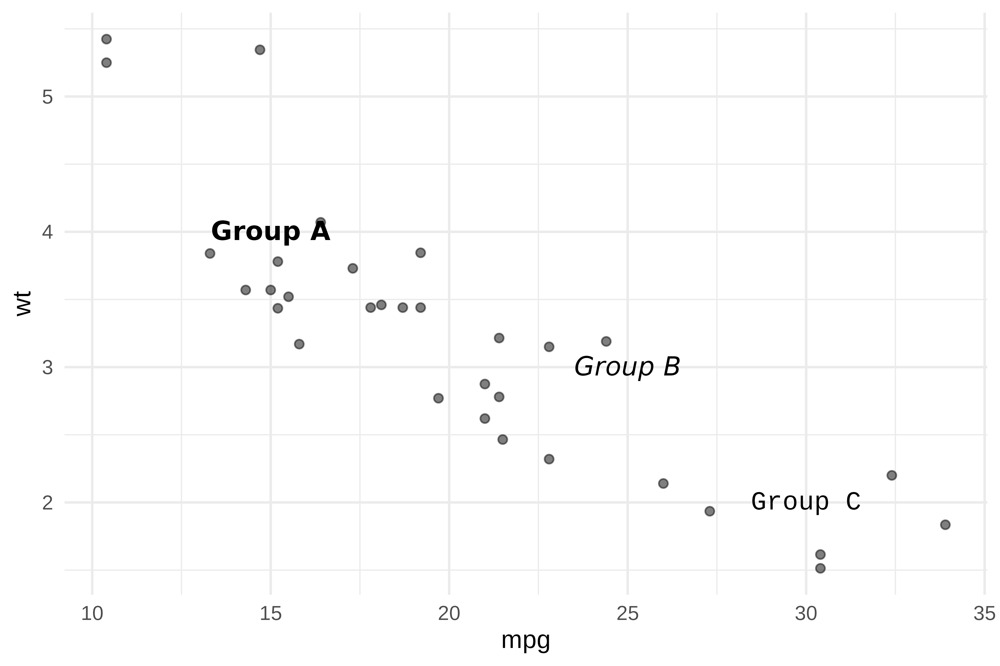

[`geom_label_md()`](https://ardata-fr.github.io/munch/reference/geom_label_md.md)
adds a background rectangle for better readability:

``` r

ggplot(mtcars, aes(mpg, wt)) +
  geom_point() +
  geom_smooth(method = "lm", se = FALSE) +
  geom_label_md(
    label = "**R\u00B2 = 0.75**\n\n*p < 0.001*",
    x = 28, y = 5,
    hjust = 0, vjust = 1,
    fill = "white",
    label.padding = unit(0.5, "lines")
  )
```

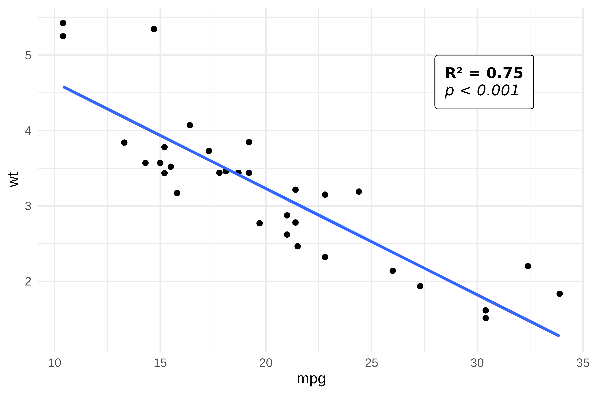

### Text wrapping

[`geom_text_md()`](https://ardata-fr.github.io/munch/reference/geom_text_md.md)
and
[`geom_label_md()`](https://ardata-fr.github.io/munch/reference/geom_label_md.md)
support the `width` parameter (in inches) for automatic line wrapping:

``` r

df <- data.frame(
  x = c(15, 30),
  y = c(4, 2.5),
  label = c(
    "This is a **long annotation** that will be *wrapped* automatically when it exceeds the specified `width`.",
    "A shorter **note**."
  )
)

ggplot(mtcars, aes(mpg, wt)) +
  geom_point(alpha = 0.3) +
  geom_text_md(
    data = df,
    aes(x = x, y = y, label = label),
    width = 2, hjust = 0, size = 3.5,
    code_font_family = "Liberation Mono"
  )
```

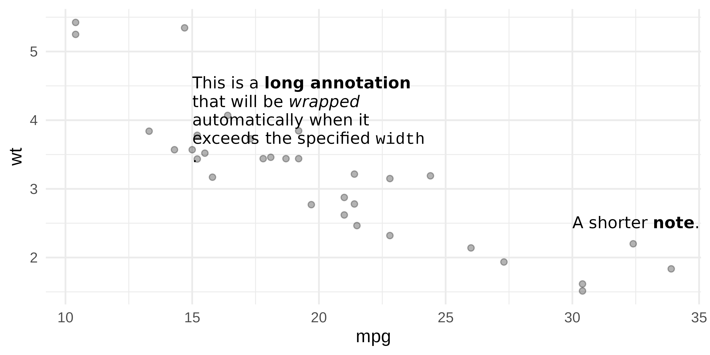

### Images in labels

Use markdown image syntax `` to embed images in
[`geom_label_md()`](https://ardata-fr.github.io/munch/reference/geom_label_md.md):

``` r

r_logo <- file.path(R.home("doc"), "html", "logo.jpg")

df <- data.frame(
  x = 20, y = 4,
  label = sprintf("Built with  and **ggplot2**", r_logo)
)

ggplot(mtcars, aes(mpg, wt)) +
  geom_point() +
  geom_label_md(
    data = df,
    aes(x = x, y = y, label = label),
    fill = "white",
    label.padding = unit(0.5, "lines")
  )
```

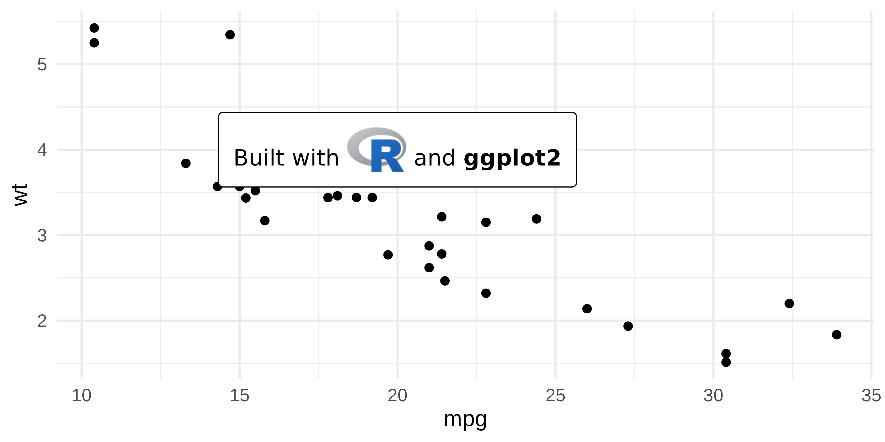

## Alignment accuracy

‘munch’ measures text with ‘gdtools’, which adds up the advance widths
of the glyphs read from the font file. Kerning, the adjustment of the
space between some pairs of letters, is not applied. Devices such as
‘ragg’, ‘svglite’ or ‘ggiraph’ apply it when they draw the text, so a
word can be drawn slightly narrower than measured.

The difference is negligible for most words, but can reach about 7% of
the width of words with pairs such as “AV”, “To” or “WA” (for example
“AVATAR”). Each word is placed at its measured position, so the
differences do not add up along a line. Their visible effects are:

- a slightly wider space after such a word;
- with `hjust = 1` (right-aligned), a line ending with such a word stops
  slightly before the right edge; with `hjust = 0.5`, the difference is
  half as large on each side; with `hjust = 0`, the left edge is exact.

Taking kerning into account in measurements is planned.

## Choosing the right approach

| Feature | [`element_md()`](https://ardata-fr.github.io/munch/reference/element_md.md) | [`element_chunks()`](https://ardata-fr.github.io/munch/reference/element_chunks.md) | `geom_*_md()` |
|----|----|----|----|
| Bold / Italic | `**text**` / `*text*` | [`as_b()`](https://davidgohel.github.io/flextable/reference/as_b.html) / [`as_i()`](https://davidgohel.github.io/flextable/reference/as_i.html) | `**text**` / `*text*` |
| Inline code | `` `text` `` | x | `` `text` `` |
| Superscript | x | [`as_sup()`](https://davidgohel.github.io/flextable/reference/as_sup.html) | x |
| Subscript | x | [`as_sub()`](https://davidgohel.github.io/flextable/reference/as_sub.html) | x |
| Colors | x | [`colorize()`](https://davidgohel.github.io/flextable/reference/colorize.html) | x |
| Highlighting | x | [`as_highlight()`](https://davidgohel.github.io/flextable/reference/as_highlight.html) | x |
| Use case | Theme elements | Theme elements | Text annotations |

- **[`element_md()`](https://ardata-fr.github.io/munch/reference/element_md.md)**,
  simple markdown in theme elements (titles, captions, axes).
- **[`element_chunks()`](https://ardata-fr.github.io/munch/reference/element_chunks.md)**,
  rich formatting with superscripts, subscripts, colors. Uses the same
  vocabulary as ‘flextable’, making it easy to reuse patterns across
  plots and tables.
- **[`geom_text_md()`](https://ardata-fr.github.io/munch/reference/geom_text_md.md)
  /
  [`geom_label_md()`](https://ardata-fr.github.io/munch/reference/geom_label_md.md)**,
  markdown annotations placed at specific coordinates on the plot.
