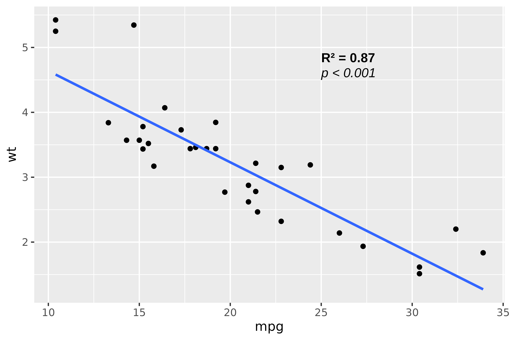

# Advanced usage

``` r

library(munch)
library(grid)
library(flextable)
```

This vignette covers advanced topics: creating grobs directly,
configuring text properties, embedding images, and ‘flextable’
integration.

## Creating grobs with md_grob()

[`md_grob()`](https://ardata-fr.github.io/munch/dev/reference/md_grob.md)
converts markdown text to a grid graphics object (grob).

### Basic usage

``` r

gr <- md_grob("This is **bold** and *italic* text.")

grid.newpage()
grid.draw(gr)
```


### Positioning and justification

Control position with `x`, `y`, `hjust`, `vjust`:

``` r

grid.newpage()

gr1 <- md_grob("**Top left**", x = 0, y = 1, hjust = 0, vjust = 1)
gr2 <- md_grob("*Center*", x = 0.5, y = 0.5, hjust = 0.5, vjust = 0.5)
gr3 <- md_grob("`Bottom right`", x = 1, y = 0, hjust = 1, vjust = 0)

grid.draw(gr1)
grid.draw(gr2)
grid.draw(gr3)
```


### Automatic text wrapping

Use `width` to enable line wrapping:

``` r

long_text <- "This is a **long text** that will be automatically
wrapped across multiple lines using the `width` parameter."

gr <- md_grob(long_text, x = 0.1, hjust = 0, width = 3)

grid.newpage()
grid.draw(gr)
```


## Creating grobs with chunks_grob()

[`chunks_grob()`](https://ardata-fr.github.io/munch/dev/reference/chunks_grob.md)
converts ‘flextable’ paragraph objects to grobs. Use this when you need
superscripts, subscripts, or custom colors.

``` r

chunks <- as_paragraph(
  as_chunk("E = mc"),
  as_sup("2")
)

gr <- chunks_grob(chunks)

grid.newpage()
grid.draw(gr)
```


### Complex formatting

``` r

chunks <- as_paragraph(
  as_chunk("The speed of light is "),
  as_b("c"),
  as_chunk(" = 3\u00D710"),
  as_sup("8"),
  as_chunk(" m/s")
)

gr <- chunks_grob(chunks)

grid.newpage()
grid.draw(gr)
```


### Colored and highlighted text

``` r

chunks <- as_paragraph(
  as_chunk("Normal "),
  colorize(as_chunk("Red "), color = "red"),
  as_highlight(as_chunk("Yellow bg"), color = "yellow")
)

gr <- chunks_grob(chunks)

grid.newpage()
grid.draw(gr)
```


## Configuring text properties

Use
[`default_text_props()`](https://ardata-fr.github.io/munch/dev/reference/default_text_props.md)
to customize font size, family, and color:

``` r

props <- default_text_props(
  font_size = 14,
  font_family = "serif",
  font_color = "darkblue",
  code_font_family = "mono"
)

gr <- md_grob("Custom **styled** text with `code`", text_props = props)

grid.newpage()
grid.draw(gr)
```


### Available parameters

| Parameter            | Description              | Default     |
|----------------------|--------------------------|-------------|
| `font_size`          | Font size in points      | 11          |
| `font_family`        | Font family              | “Helvetica” |
| `font_color`         | Text color               | “black”     |
| `code_font_family`   | Font for inline code     | “mono”      |
| `line_spacing`       | Line height multiplier   | 1.2         |
| `img_baseline_ratio` | Image vertical alignment | 0.15        |

### Integration with flextable theming

Text properties can also be set globally via ‘flextable’:

``` r

set_flextable_defaults(
  font.size = 14,
  font.color = "darkblue"
)

gr <- md_grob("Text using **flextable** defaults")

grid.newpage()
grid.draw(gr)
```


``` r


# Reset defaults
init_flextable_defaults()
```

## Embedding images

### In markdown

Use standard markdown image syntax:

``` r

img_path <- system.file("img", "Rlogo.png", package = "png")

text_with_img <- sprintf("The R logo:  in text.", img_path)

gr <- md_grob(text_with_img)
#> Warning: Image file not found.
#> ✖ Cannot find file .

grid.newpage()
grid.draw(gr)
```


### With flextable chunks

Use
[`as_image()`](https://davidgohel.github.io/flextable/reference/as_image.html)
for explicit size control:

``` r

img_path <- system.file("img", "Rlogo.png", package = "png")

chunks <- as_paragraph(
  as_chunk("The R logo "),
  as_image(src = img_path, width = 0.3, height = 0.3),
  as_chunk(" is iconic.")
)

gr <- chunks_grob(chunks)
#> Warning: Image file not found.
#> ✖ Cannot find file .

grid.newpage()
grid.draw(gr)
```


### Image baseline alignment

The `img_baseline_ratio` parameter controls vertical image alignment:

- `0`: Image bottom at text baseline
- `0.15`: (default) Similar to text descent proportions
- `0.35`: Image centered on text vertical center
- `0.5`: Image centered on baseline

``` r

props <- default_text_props(img_baseline_ratio = 0.35)

gr <- md_grob(
  sprintf("Text  centered", img_path),
  text_props = props
)
#> Warning: Image file not found.
#> ✖ Cannot find file .

grid.newpage()
grid.draw(gr)
```


## Using grobs in ggplot2

Use
[`annotation_custom()`](https://ggplot2.tidyverse.org/reference/annotation_custom.html)
to add grobs to ggplot2:

``` r

library(ggplot2)

stats_grob <- md_grob(
  "**R\u00B2 = 0.87**\n\n*p < 0.001*",
  hjust = 0,
  vjust = 1
)

ggplot(mtcars, aes(mpg, wt)) +
  geom_point() +
  geom_smooth(method = "lm", se = FALSE) +
  annotation_custom(
    grob = stats_grob,
    xmin = 25, xmax = 35,
    ymin = 4.5, ymax = 5.5
  )
```



## Flextable integration

Use
[`as_paragraph_md()`](https://ardata-fr.github.io/munch/dev/reference/as_paragraph_md.md)
for markdown in table cells:

``` r

ft <- flextable(head(iris, 3))
ft <- mk_par(ft, j = 1, part = "header",
  value = as_paragraph_md("*Sepal* **Length**"))
autofit(ft)
```

| Sepal Length | Sepal.Width | Petal.Length | Petal.Width | Species |
|--------------|-------------|--------------|-------------|---------|
| 5.1          | 3.5         | 1.4          | 0.2         | setosa  |
| 4.9          | 3.0         | 1.4          | 0.2         | setosa  |
| 4.7          | 3.2         | 1.3          | 0.2         | setosa  |
